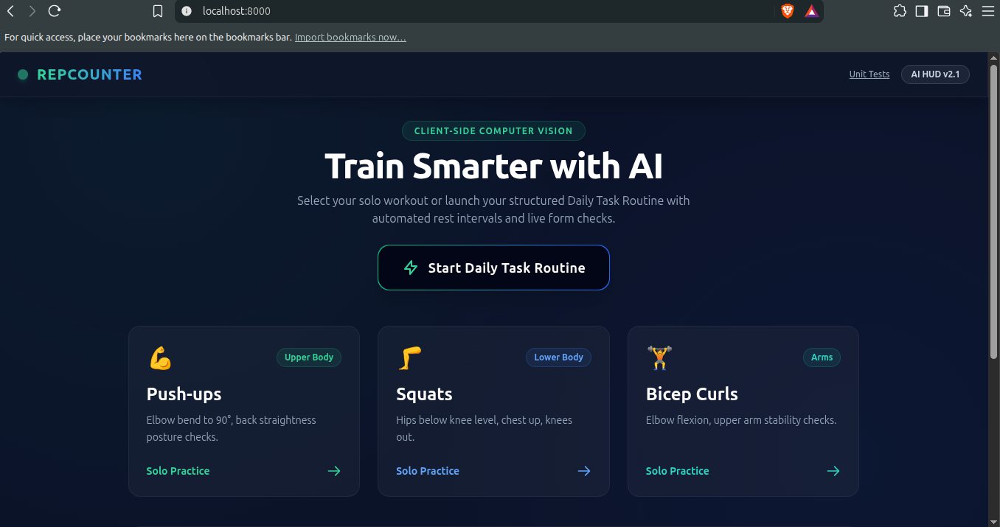

# 🏋️ RepCounter: AI Fitness Trainer

[](https://developer.mozilla.org/)
[](https://tailwindcss.com/)
[](https://developer.mozilla.org/)
[](https://developers.google.com/mediapipe)
[](https://opensource.org/licenses/MIT)

> **An intelligent, privacy-first browser-based fitness HUD and Daily Task Routine system powered by real-time computer vision with zero server uploads.**

---

## 📸 Demo Preview

> *Replace `demo.gif` with your actual demo recording or screenshot.*



---

## 📑 Table of Contents

- [✨ Key Features](#-key-features)
- [🛠️ Tech Stack & Architecture](#️-tech-stack--architecture)
- [🚀 Quick Start (How to Run)](#-quick-start-how-to-run)
- [🧪 Running Unit Tests](#-running-unit-tests)
- [🏆 The Hackathon (Devpost)](#-the-hackathon-devpost)
- [📜 License](#-license)

---

## ✨ Key Features

- [x] **Real-time AI Pose Estimation:** Runs 100% client-side in your browser via Google MediaPipe Pose with zero video uploads and complete privacy.
- [x] **Structured Daily Task Routine:** Configure and persist custom rep targets for Push-ups, Squats, and Bicep Curls with automated routine progression.
- [x] **2-Minute Auto-Rest Timer:** Automatically triggers an animated countdown rest timer between exercises with a manual 'Skip Rest' option.
- [x] **Live Posture & Form Checking:** Real-time visual feedback badges (Green for correct form, glowing red alert for posture warnings).
- [x] **Persistent Local Storage History:** Automatically saves set summaries, rep counts, and routine scores to browser LocalStorage.

---

## 🛠️ Tech Stack & Architecture

RepCounter is built with a modular, zero-build-step ES6 architecture designed for blazing-fast performance on any hardware:

```
RepCounter/
├── index.html              # Modern Glassmorphic Dashboard, Workout HUD, Setup & Rest Modals
├── style.css               # Custom theme, animations, and circular progress ring
├── src/
│   ├── pose.js             # MediaPipe camera stream & keypoint extractor
│   ├── counter.js          # 3-point angle math, moving average smoothing, & finite state machine
│   ├── rules.js            # Exercise configurations & form posture rules
│   ├── storage.js          # LocalStorage persistence manager
│   └── routine.js          # Daily Task Routine queue & rest interval manager
└── tests/
    └── test.html           # Browser unit test suite for angle math, state machine, & persistence
```

### How Counting & Timers Work
1. **Keypoint Streaming:** MediaPipe Pose extracts 3D body keypoints per video frame.
2. **Angle Calculation & Smoothing:** Joint angles are computed and filtered through a 5-frame moving average to eliminate camera jitter.
3. **Finite State Machine:** Reps increment precisely when crossing hysteresis thresholds between "up" and "down" states.
4. **Routine Queue & Rest Timer:** Automatically sequences exercises and counts down rest periods using interval timers.

---

## 🚀 Quick Start (How to Run)

To run RepCounter locally on your laptop:

1. **Clone the repository:**
   ```bash
   git clone https://github.com/your-username/RepCounter.git
   #cd RepCounter
   ```
2. **Start a local static web server:**
   ```bash
   python3 -m http.server 8000
   ```
3. **Open your browser** and navigate to:
   ```
   http://localhost:8000
   ```
4. **Allow webcam access** when prompted and start training!

---

## 🧪 Running Unit Tests

To verify the core math, state machine rep counting, and local storage persistence:

1. Ensure your local server is running (`python3 -m http.server 8000`).
2. Open your browser and navigate to:
   ```
   http://localhost:8000/tests/test.html
   ```

---

## 🏆 The Hackathon (Devpost)

This project was built for the **Build With AI: Basics** hackathon, demonstrating end-to-end AI agent collaboration and plan-first software development. 

Explore our planning artifacts in the `devpost/` directory:
- [`scope.md`](devpost/scope.md) — Project scope and kernel definition
- [`prd.md`](devpost/prd.md) — Product requirements and user journey
- [`spec.md`](devpost/spec.md) — Technical specification and architecture
- [`checklist.md`](devpost/checklist.md) — Build checklist and execution log
- [`app-map.html`](devpost/app-map.html) — Visual take-home architecture map

---

## 📜 License

This project is open-source and available under the [MIT License](LICENSE).
